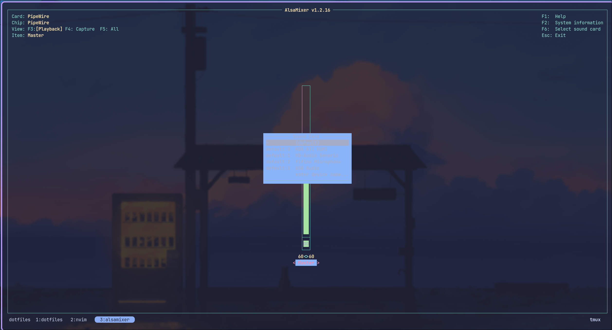
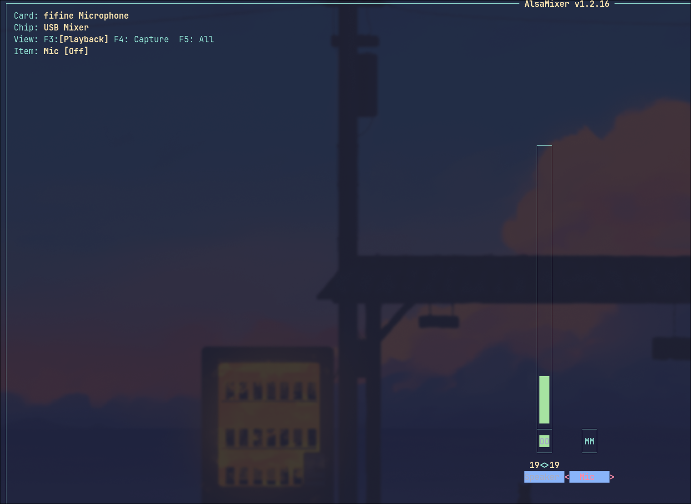

# Arch Configuration

## Syncing up the Linux packages
The list of linux packages can be found in the arch.txt which is found at the
root of the directory
- For resyncing the packages then it is run through this command 
`pacman -Qqe > arch.txt`

## Turning off mic Playback
The `mic-playback-off` script will automatically turn off playback and should
run on hyprland init

There is an annoying issue with the cheap Fifine mic, where it will have
autoplayback enabled and keep trying to enable it.
- On linux this is disabled through use of alsamixer.

1. Open up Alsamixer which is downloaded through  and change the input to fifine
   mic
    - `sudo pacman -S alsa-utils`

2. From Fifine mic you want to use the right arrow key to go over to the mic and
   then push M.
   - Make sure that at the top it says that the Card is Fifine Microphone
   - You want the mic to show MM on that column which means it is Mic Muted

3. Turn up the mic and make sure that you don't hear yourself
    

## Voice to text

### Handy

[Handy](https://handy.computer) is installed from the AUR (`handy-bin` in
`arch.txt`). Right Alt is the hold-to-talk key: hold it, talk, let go.

How the key gets to Handy:
- `keyd` remaps right Alt to F19 (`keyd/etc/keyd/default.conf`)
- Hyprland binds F19 press and release to `~/.utils/handy-ptt start` / `stop`
  (`hypr/.config/hypr/hyprland.lua`)
- `handy-ptt` checks if Handy is really recording and only then sends it the
  toggle signal, so hold-to-talk cannot end up inverted

Handy's own settings are not in the dotfiles, so these need to be set by hand
on a new machine:

1. Turn off Handy's built-in keyboard shortcuts. Handy runs through XWayland,
   so its own shortcut only fires while an X11 window is focused, and if it is
   left on it can fire on top of the Hyprland bind and double toggle.
    - Quit Handy first, it rewrites the file when it saves
    - In `~/.local/share/com.pais.handy/settings_store.json` set
      `"keyboard_implementation": "none"` (the default is `"tauri"`)
    - This also turns off Handy's Escape to cancel shortcut

2. Make sure `wtype` is installed (it is in `arch.txt`). Without it Handy types
   the text through X11 and nothing shows up in Wayland windows like ghostty or
   Chrome.
    - `wtype` types the text character by character, that is expected
